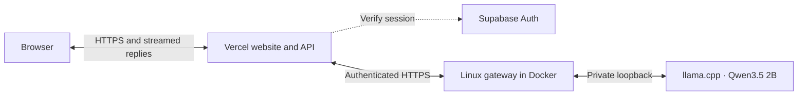

<p align="center">
  
</p>

<h1 align="center">Offscript_</h1>
<p align="center"><strong>Temporary AI chat with self-hosted inference.</strong></p>
<p align="center">Ask. Think. Disappear.</p>
<p align="center">
  <a href="https://offscript-ai.vercel.app/"><strong>Try Offscript</strong></a> ·
  <a href="#how-it-works">Architecture</a> ·
  <a href="#develop-locally">Develop locally</a>
</p>

Offscript is a browser-based AI chat for asking questions without building a permanent conversation archive. Sign in with GitHub, choose **Fast** or **Deep Think**, and watch the answer stream in. The chat stays in the open page. Your account can persist separately.

The website and authentication run on managed services. A separate Linux host runs the model on its CPU. Each layer has a clear job, so we can work on inference speed and answer quality without rebuilding the whole product.

## What’s live

- **Temporary conversations.** Reloading the page or closing the chat clears the conversation. Offscript has no saved chat history.
- **Two reply modes.** Fast starts generating without a dedicated reasoning phase. Deep Think can spend additional tokens on reasoning before it replies.
- **Streaming and recovery.** Answers appear as they arrive. Stop a reply or retry an interrupted answer from the conversation.
- **Responsive chat.** The same interface works on phones and desktops, with terminal-style replies, Markdown, and code formatting.

## How it works



**React, TypeScript, and Vite** build the client. **Vercel and Hono** serve the API and verify Supabase sessions before forwarding a request through Tailscale. **Docker** runs the ingress, gateway, and inference engine on the Linux host. The gateway counts tokens against the configured context window, bounds the queue, and clears temporary inference state between requests.

The pilot serves **HauhauCS Qwen3.5-2B Aggressive**, a `Q4_K_M` GGUF model, through **llama.cpp**. The current host serves one generation at a time. Answer quality, latency, and concurrency are separate release goals, each measured before a runtime change goes live. See the [model profile](docs/MODEL-PROFILE.md) and [Docker guide](docs/DOCKER.md).

## Develop locally

Use **Node.js 24 or later** and **Python 3** for the test suite.

```sh
git clone https://github.com/Mher-1902/uncensored-ai.git
cd uncensored-ai
npm ci
npm run dev
```

This starts the frontend preview. To connect real sign-in and streaming chat, follow the [Vercel service setup](docs/VERCEL.md), [account setup](docs/ACCOUNTS.md), and [Docker backend guide](docs/DOCKER.md) with your own configuration.

```sh
npm ci --prefix cloud/vercel-api
npm ci --prefix cloud/vercel-gateway
npm run build
npm run check:seo
npm test
```

## Project layout

| Path | Responsibility |
| --- | --- |
| `src/` | Chat interface, account state, and browser streaming |
| `cloud/vercel-api/` | Public API and browser configuration |
| `cloud/vercel-gateway/` | Session verification and upstream routing |
| `server/` | Request validation, queuing, and inference adapter |
| `self-host/` and `docker/` | Model setup, container runtime, and thermal controls |
| `supabase/` | Account and usage schema migrations and isolation tests |
| `ops/monitoring/` | Prometheus and Grafana configuration |

## Where it’s going

The priorities are more reliable answers, lower inference latency, account controls, and measured capacity. See the [roadmap](docs/ROADMAP.md) for the work behind those goals. See [security requirements](SECURITY.md) for the project’s data and deployment boundaries.
