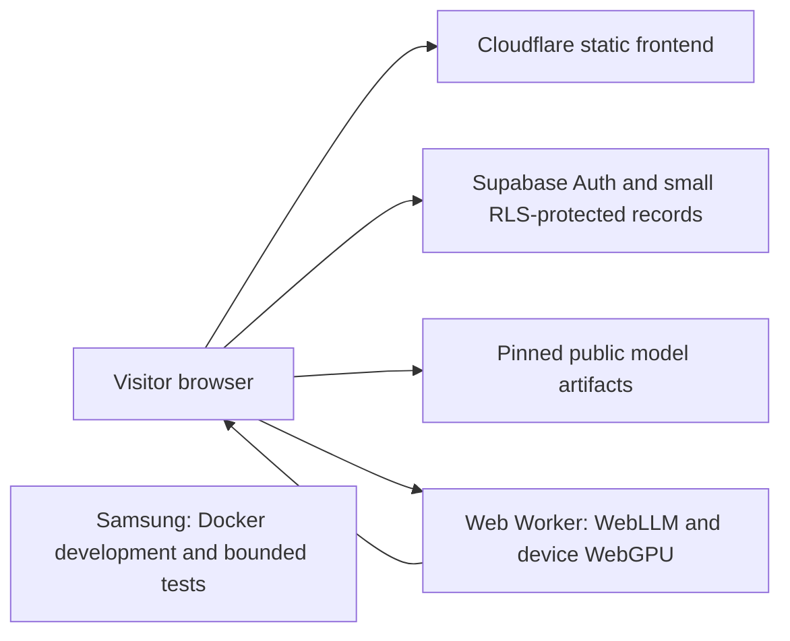

# Capacity decision: 50,000 users with a $0 provider budget

October 16, 2026. Status: researched architecture proposal, **not deployed or load-certified**. The owner requires no paid providers, trials, hardware purchases or automatic overage. This document supersedes earlier assumptions that a free GPU can underpin public growth. The existing Samsung development deployment remains operational.

## Decision

Pursue **inference on each visitor's device** as the primary feasibility experiment: WebLLM/MLC using WebGPU, a static frontend, and the existing Supabase Auth/PostgreSQL project. Keep the Samsung for development, control and bounded testing. This distributes generation across visitors' hardware instead of putting every request into one laptop or free GPU queue.

This is a plausible route toward a $0 provider bill for a restricted text product. It does **not** establish support for 50,000 simultaneous users, every phone, unlimited usage, cloud chat history or image generation. Fast centralized generation for arbitrary devices and guaranteed 50,000-way concurrency cannot be promised under the verified free offers. A provider changing its allowance can also invalidate the design.

## Define and calculate the workload

Registered accounts, monthly active users (MAU), daily active users (DAU), concurrent site visitors and concurrent generations are different quantities. Use the following explicit scenarios until product telemetry exists. These are planning assumptions, not measured demand or GPU benchmark results.

Assume 300 generated tokens per reply, a 30-day month, and a hypothetical 10-second generation duration. Exclude input processing, hidden reasoning, retries and operational headroom; real central capacity needs more.

| Scenario | Requests | Average generated tokens/second | Average active generations at 10 seconds/reply |
| --- | ---: | ---: | ---: |
| 50,000 MAU, 10 replies/person/month | 500,000/month; 16,667/day | 57.9 | 1.93 |
| 50,000 DAU, 10 replies/person/day | 500,000/day | 1,736.1 | 57.87 |
| 50,000 simultaneous requests, each completed in 10 seconds | 50,000 in one burst | 1,500,000 over that interval | 50,000 |

For a hypothetical 10-times-average peak, the first two cases require about 19 and 579 active generations respectively. Neither number is a proven free-GPU concurrency limit. For a real server, measure aggregate output tokens/second, first-token latency, queue delay, input lengths, batch size, memory, failures and cold starts using the exact checkpoint and serving engine.

The current Samsung runs **one generation slot** with a bounded queue of 32. The selected Qwen3.5 2B Direct sample produced 63 tokens in 25.111 seconds, with first text at 4.994 seconds. Its rough decode rate is about 3 tokens/second. Even an idealized continuous 3 tokens/second gives only 864 replies/day at 300 tokens each, before input processing or downtime. That is already about 19 times below the first scenario's average demand. Changing the engine does not justify claiming otherwise.

## Proposed service boundaries

| Component | Proposed responsibility | Boundary for a $0 bill |
| --- | --- | --- |
| Cloudflare Pages/static assets | HTML, JavaScript, styles, small assets and public configuration on a provider subdomain | Static requests are free/unlimited; Free Pages has 500 builds/month and a 25 MiB single-asset limit. Do not package the model as one site asset. |
| Supabase Free | Existing GitHub login; later small indexed user records with reviewed migrations and RLS | 50,000 MAU, 500 MB database and 5 GB uncached egress are allowances, not concurrency guarantees. Measure actual Auth/profile storage before accepting 50,000 accounts. No per-token writes, chat archive or per-user Realtime subscription. |
| WebLLM/MLC | Generate text in a Web Worker using the visitor's GPU | Device capability, memory, download time, quality and speed must pass testing. No central per-message inference service on the default path. |
| Public model distribution | Immutable, licensed MLC artifacts and matching WASM with pinned provenance | Initial candidate is a public Hugging Face model repository. Distribution eligibility, CORS and sustained delivery must be validated before mass rollout; there is no verified 50,000-download SLA. |
| Samsung | Remote development/builds and deliberately small server tests | Preserve thermal, memory, swap and authentication limits. Do not silently route unsupported browsers into an unbounded fallback queue. |
| Free external GPU | Optional experiments or a small demonstration | Quota exhaustion means unavailable. No paid fallback, quota evasion or multiplying accounts to manufacture capacity. |

Cloudflare's dynamic functions have a separate Free allowance of 100,000 requests/day shared with Workers. Keep model token streaming local and static assets out of functions. A Worker is not a free LLM GPU. [Pages pricing](https://developers.cloudflare.com/pages/functions/pricing/), [Pages limits](https://developers.cloudflare.com/pages/platform/limits/), [static assets](https://developers.cloudflare.com/workers/static-assets/billing-and-limitations/).

Supabase also has shared compute, no included automatic database backups and inactivity pausing on Free. Avoid adding a second Auth provider such as Clerk or a second database such as Neon without an actual requirement; doing so does not create inference capacity. Keep OAuth for now because public email/password delivery still lacks a configured domain/sender. [Supabase allowances](https://supabase.com/pricing).

The current Vercel Hobby plan restricts use to personal, non-commercial projects. Before a commercial launch, prepare a separate Cloudflare static deployment and migrate the homepage, exact OAuth return URL, CSP and canonical metadata together. Retain the present development site until the replacement passes validation. No paid Vercel upgrade is authorized. [Vercel Hobby](https://vercel.com/docs/plans/hobby).

## Model compatibility and delivery are release gates

WebLLM is an independent WebGPU/MLC engine, not a wrapper around llama.cpp. Its current documentation covers Qwen3.5 recurrent state, but architecture support is not proof that our selected derivative works. The production **HauhauCS/Qwen3.5-2B-Uncensored-HauhauCS-Aggressive Q4_K_M GGUF cannot be loaded directly** as an MLC model. A reproducible conversion needs the exact approved checkpoint, compatible weights, tokenizer/template, quantization settings, compiled WASM, license notices and checksums. Do not silently substitute the stock Qwen model or a different derivative. [WebLLM](https://webllm.mlc.ai/docs/), [custom models and Qwen3.5 state](https://webllm.mlc.ai/docs/user/advanced_usage.html).

The initial model download will be large and is not the same as time to first token after loading. As an illustrative lower-order estimate, 50,000 first downloads of a 1.27 GB model total **63.5 TB**. Actual MLC artifacts may have a different size. Weight caching reduces repeat downloads, but reinstallations, browser eviction and mobile data remain significant. Obtain explicit opt-in before the download and local GPU work. Show the size, capability result, progress and cancellation. Cache model artifacts only; keep chats ephemeral as today.

R2 is an option to evaluate, not a guaranteed-zero-cost bucket. Its Standard free tier includes 10 GB-month, 1 million Class A and 10 million Class B operations; egress is free but excess storage/operations are billable. Do not enable a public metered bucket without a verified way to enforce the owner's zero-spend requirement. Alerts alone are not a hard cap. [R2 pricing](https://developers.cloudflare.com/r2/pricing/).

On unsupported or slow devices, offer an honest compatibility result and the bounded development service only when capacity allows. Local inference does not automatically make an old phone faster than the Samsung. Do not advertise universal support or a latency percentile before device measurements exist.

## Why a free GPU is not the capacity foundation

Hugging Face ZeroGPU currently gives a free account **five GPU minutes/day** and shared queue access. At an illustrative ten GPU-seconds per reply, that is 30 replies/day for that account's allowance; it is not a measurement of our model or a reserved concurrency allocation. External visitor identity/quota rules need explicit provider validation before any integration. There is no verified free offer here guaranteeing fast central inference at the workloads above. [ZeroGPU quotas](https://huggingface.co/docs/hub/spaces-zerogpu).

vLLM is a serving engine, not a provider of free compute. Samsung's i7-3517U lacks AVX2; documented x86 vLLM CPU support requires newer instructions. A compatible GPU and model build would need real benchmarks before selecting vLLM. [vLLM CPU requirements](https://docs.vllm.ai/en/latest/getting_started/installation/cpu/).

A separate MNN 3.6.1 experiment imported its LLM module and passed native CPU matrix multiplication on this Samsung inside a network-isolated, read-only container. This establishes basic CPU execution only. No model was loaded, no LLM speed was measured, and production remains on llama.cpp. MNN also needs converted artifacts; it is not a demonstrated 50,000-user solution. [MNN release](https://github.com/alibaba/MNN/releases/tag/3.6.1).

## Data isolation, spending and availability

- Keep each user's future database rows owned by the authenticated subject. Enable default-deny RLS before exposure; test owner, another user, anonymous access and ownership-transfer attempts. Keep administrative/service credentials out of browser bundles. There are no new application tables in this change.
- Authenticate any central fallback and apply shared per-user admission limits before replication. Client-side limits cannot protect a server. An Auth login alone does not prevent server abuse. Local model execution does not grant access to other users' data.
- Preserve ephemeral chats, strict asset allowlists and no prompt/reply telemetry. A browser experiment needs a scoped WASM CSP design and self-hosted pinned executable artifacts; do not enable broad `unsafe-eval` or relax production security to make a demo work.
- Keep providers on explicitly free plans. Do not add payment methods, trials, paid failover, overage-enabled storage or auto-upgrades. Verify account budgets before describing the entire deployed stack as hard-capped at $0. Stop accepting work when free limits are reached; stopping service is the necessary tradeoff for a strict zero-spend requirement.
- Private GitHub repositories also consume finite CI minutes/storage. GitHub Free currently includes 2,000 Actions minutes/month. Verify zero-dollar stop-usage budgets; trim artifact retention and avoid rebuilding an unchanged model image for every documentation edit in a later delivery change. These account budgets have not been inspected or modified here. [GitHub included usage](https://docs.github.com/en/billing/reference/product-usage-included).
- Proposed warning thresholds: 80% of MAU, database, egress, build and CI allowances. At 40,000 MAU, review growth before the 50,000 ceiling. These are proposed operational gates, not implemented signup caps; an existing user's return can increase MAU even when new signup is paused. Disable optional cloud writes/downloads before exhaustion. A free plan cannot provide a paid uptime guarantee.
- Later monitoring should export bounded aggregate counters, dependency health, queue delay and resource usage to the external Grafana plan. Do not create Grafana now; that work remains deferred. No prompts, replies, tokens or account identifiers in metrics.

## Incremental delivery and acceptance criteria

1. **Artifact feasibility:** obtain and license-check compatible source weights for the exact selected derivative; perform a reproducible conversion on the Samsung under resource/thermal guards. If the host cannot complete conversion safely, record the blocker instead of booking paid compute. Pin every output. Do not download several models speculatively.
2. **Private prototype:** implement a separate local-inference adapter behind an off-by-default flag. Test WebGPU capability, worker lifecycle, loading, streaming, abort, unload, cleared chat state and failed downloads. Existing production stays on its verified backend until the replacement works.
3. **Device and quality gate:** test the Mac, available iPad/phone and a modest Windows/Linux device where available. Separate cold download, cold load, warm first-token and generation measurements. Proposed minimum supported-device targets: warm p95 first text at most 3 seconds and at least 15 generated tokens/second for fixed 300-token Direct responses, across 30 warm samples. Compare a fixed general chat, arithmetic, coding and instruction-following set against the approved current model. These are acceptance targets, not achieved results.
4. **Static-host staging:** deploy the prototype on the chosen free static host, validate exact OAuth returns, CSP, asset integrity, accessibility and ephemeral behavior. Preserve reviewed PRs and CI. Account creation/terms or new credentials are handled by the owner when required.
5. **Staged admission:** begin with 10, then 100, then 1,000 compatible users while measuring artifact failure rate and free-tier headroom. Establish device success criteria before claiming 50,000 MAU. Validate Auth bursts with synthetic workloads in an authorized staging environment, within provider limits; do not attack the production service with 50,000 requests.

Abandon the browser-first path if the exact derivative cannot be converted reliably, supported target devices miss quality/latency targets, initial downloads are unacceptable, or safe artifact distribution cannot stay within the budget. At that point, choose a smaller audience/feature set or change the funding constraint. Do not hide a paid dependency or claim a free GPU solves the gap. Image generation and future Cue integration need separate measured capacity plans.

This PR changes documentation only. It does not deploy WebLLM, Cloudflare, GPU services, database schema, billing controls or new model weights.
